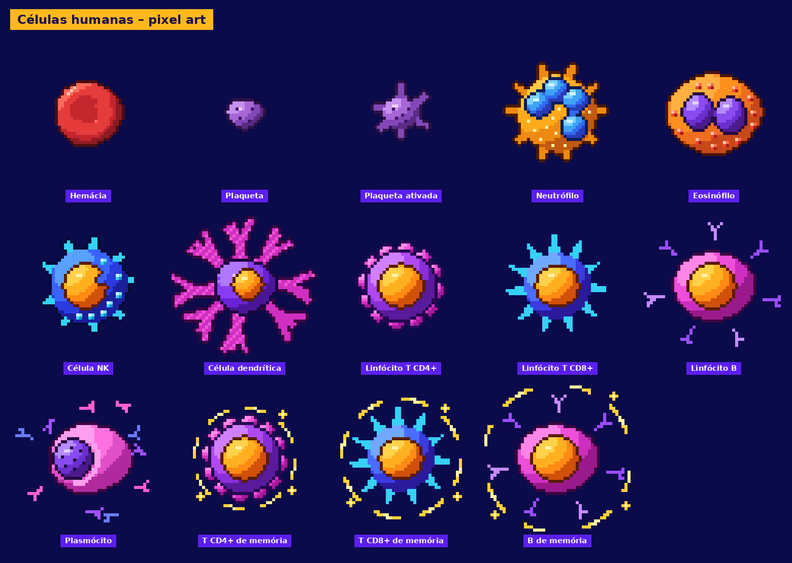

# Células humanas em pixel art

Sprites gerados por `tools/gerar_celulas.py`. Paleta e formas inspiradas na
referência *"The Immune System"*. O estilo segue os personagens pixelados:
contorno escuro de 1 px, 4 tons de sombreamento com luz vindo do canto superior
esquerdo e um pixel de brilho.

## Arquivos

| Pasta / arquivo | Conteúdo |
|---|---|
| `png/` | Sprite original de cada célula, **48×48 px**, fundo transparente |
| `png_x8/` | O mesmo sprite ampliado 8× (384×384), sem suavização |
| `spritesheet.png` | Todos os sprites numa linha (14 × 48 px), na ordem da tabela abaixo |
| `spritesheet_preview.png` | Prévia com legendas, sobre fundo escuro |

## Células

| # | Arquivo | Célula | Como reconhecer |
|---|---|---|---|
| 0 | `hemacia` | Hemácia | Disco vermelho bicôncavo, sem núcleo |
| 1 | `plaqueta` | Plaqueta | Pequeno fragmento lilás com grânulos |
| 2 | `plaqueta_ativada` | Plaqueta ativada | Com pseudópodes (para cenas de coagulação) |
| 3 | `neutrofilo` | Neutrófilo | Corpo laranja espiculado, núcleo azul com 4 lobos |
| 4 | `eosinofilo` | Eosinófilo | Núcleo bilobado roxo, grânulos vermelho-alaranjados |
| 5 | `celula_nk` | Célula NK | Azul com grânulos ciano (linfócito grande granular) |
| 6 | `celula_dendritica` | Célula dendrítica | Prolongamentos magenta ramificados |
| 7 | `linfocito_t_cd4` | Linfócito T CD4+ | Violeta, com "bolinhas" rosa na membrana |
| 8 | `linfocito_t_cd8` | Linfócito T CD8+ | Azul, com espículas ciano |
| 9 | `linfocito_b` | Linfócito B | Rosa oval com BCR (pequenos Y) na superfície |
| 10 | `plasmocito` | Plasmócito | Núcleo excêntrico "em roda de carroça", halo de Golgi, anticorpos soltos |
| 11 | `memoria_t_cd4` | T CD4+ de memória | T CD4+ com aura dourada |
| 12 | `memoria_t_cd8` | T CD8+ de memória | T CD8+ com aura dourada |
| 13 | `memoria_b` | B de memória | Linfócito B com aura dourada |

## Para animação

* Todos os sprites usam o mesmo canvas de 48×48 px, com o centro da célula em
  (24, 24). Dá para trocar, girar ou pulsar sem realinhar.
* O tamanho relativo entre as células é aproximadamente realista: a plaqueta é
  pequena e a hemácia é menor que os leucócitos.
* Para ampliar, use sempre *nearest neighbor* (sem suavização). Em CSS:
  `image-rendering: pixelated;`.
* Para regerar ou ajustar cores e formas: `python3 tools/gerar_celulas.py`.
