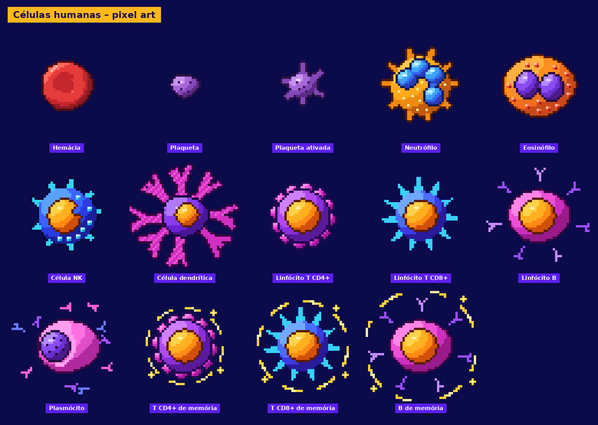

# Guia de células humanas em pixel art



Kit reutilizável com **14 sprites** de células do sangue e do sistema imune, no mesmo estilo
visual. Inclui as regras de estilo, as paletas, uma ficha técnica por célula, ideias de animação,
um prompt pronto para criar novas células e o script que gera tudo.

## Estrutura da pasta

```
guia-celulas/
├── README.md                 ← este índice
├── 01-estilo-visual.md       ← regras de pixel art (canvas, luz, contorno, tons)
├── 02-paletas.md             ← todas as paletas com códigos hex
├── 03-animacao.md            ← convenções e dicas para animar
├── 04-prompt-novas-celulas.md← prompt para gerar novas células no mesmo estilo
├── 05-uso-em-projetos.md     ← como usar em HTML/CSS, Phaser, Godot, Unity, vídeo
├── celulas/                  ← 1 ficha .md por célula
├── sprites/png/              ← sprites 48×48 (originais)
├── sprites/png_x8/           ← sprites 384×384 (ampliados sem suavização)
├── sprites/spritesheet.png   ← todas as células em 1 linha (atlas 672×48)
├── paletas/                  ← amostras de cor em .png
├── ferramentas/              ← gerar_celulas.py e gerar_guia.py
└── guia-celulas.pdf          ← este guia completo em PDF
```

## Células

| # | Célula | Arquivo |
|---|---|---|
| 0 | [Hemácia (eritrócito)](celulas/hemacia.md) | `hemacia.png` |
| 1 | [Plaqueta (trombócito)](celulas/plaqueta.md) | `plaqueta.png` |
| 2 | [Plaqueta ativada](celulas/plaqueta_ativada.md) | `plaqueta_ativada.png` |
| 3 | [Neutrófilo](celulas/neutrofilo.md) | `neutrofilo.png` |
| 4 | [Eosinófilo](celulas/eosinofilo.md) | `eosinofilo.png` |
| 5 | [Célula NK (natural killer)](celulas/celula_nk.md) | `celula_nk.png` |
| 6 | [Célula dendrítica](celulas/celula_dendritica.md) | `celula_dendritica.png` |
| 7 | [Linfócito T CD4+ (auxiliar / helper)](celulas/linfocito_t_cd4.md) | `linfocito_t_cd4.png` |
| 8 | [Linfócito T CD8+ (citotóxico)](celulas/linfocito_t_cd8.md) | `linfocito_t_cd8.png` |
| 9 | [Linfócito B](celulas/linfocito_b.md) | `linfocito_b.png` |
| 10 | [Plasmócito](celulas/plasmocito.md) | `plasmocito.png` |
| 11 | [Linfócito T CD4+ de memória](celulas/memoria_t_cd4.md) | `memoria_t_cd4.png` |
| 12 | [Linfócito T CD8+ de memória](celulas/memoria_t_cd8.md) | `memoria_t_cd8.png` |
| 13 | [Linfócito B de memória](celulas/memoria_b.md) | `memoria_b.png` |

## Regras de ouro (resumo)

1. Canvas **48×48 px**, fundo transparente, centro da célula em **(24, 24)**.
2. Luz vindo do **canto superior esquerdo**.
3. **4 tons** por material (sombra, meio-tom, base, luz) + 1 brilho + 1 contorno.
4. **Contorno de 1 px** em vizinhança 4 (sem diagonais), num tom escuro da própria cor.
5. Núcleo com contorno próprio, desenhado **por cima** do citoplasma.
6. Ampliar **sempre** em múltiplos inteiros e com *nearest neighbor*.
7. Células de memória = célula de origem + **aura dourada tracejada**.
