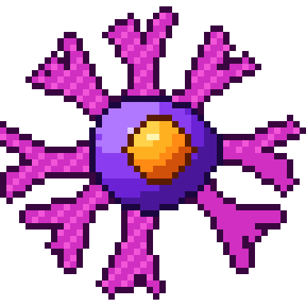

# Célula dendrítica

| Campo | Valor |
|---|---|
| Arquivo | `sprites/png/celula_dendritica.png` (48×48) · `sprites/png_x8/celula_dendritica.png` (384×384) |
| Índice no spritesheet | 6 (x = 288 px) |
| Tamanho real | corpo ~10–15 µm; prolongamentos de até 50 µm ou mais |
| Área ocupada no sprite | 48×46 px |
| Paletas | Corpo → `DC_BODY`, Dendritos → `MAGENTA`, Núcleo → `NUC_ORANGE` |

## Biologia

Principal célula apresentadora de antígeno. Vive nos tecidos (pele, mucosas) capturando antígenos. Ao ser ativada, migra pelos vasos linfáticos até o linfonodo e apresenta peptídeos no MHC I e II aos linfócitos T virgens, decidindo o tipo de resposta. É a ponte entre a imunidade inata e a adaptativa.

## Como reconhecer no sprite

- Corpo roxo pequeno e **8 dendritos magenta ramificados**
- Núcleo laranja levemente deslocado

## Construção (camadas, de trás para frente)

1. 8 braços a cada 45° (±8°): tronco de 6 px até 14,5 ± 1,5 px (largura 4,0 → 2,0)
2. Na ponta do tronco: 2 ramos a ±30° (largura 2,2 → 1,0, comprimento ~8 px) + 1 prolongamento central (+6,5 px)
3. Textura nos dendritos: 1 em cada 3 pixels em *base* na metade iluminada
4. Corpo: elipse 9,3 × 8,6 sombreada
5. Contorno externo magenta escuro + anel do corpo em roxo escuro
6. Núcleo: elipse 4,6 × 4,4 em (25, 23,5)

## Cores

| Parte | Contorno | Sombra | Meio-tom | Base | Luz | Brilho |
|---|---|---|---|---|---|---|
| **Corpo** `DC_BODY` | `#1c0640` | `#4a1699` | `#6a22d4` | `#8a3df0` | `#b078ff` | `#e2cbff` |
| **Dendritos** `MAGENTA` | `#3a0640` | `#a5189b` | `#d12fc2` | `#f255d8` | `#ff8be8` | `#ffd0f6` |
| **Núcleo** `NUC_ORANGE` | `#5a1c00` | `#d1500a` | `#ff8a14` | `#ffb020` | `#ffd24a` | `#fff3b0` |

## Ideias de animação

- Dendritos "ondulando": deslocar as pontas ±1 px em quadros alternados
- Migração: encolher os dendritos (70 %) enquanto se move e estendê-los ao chegar ao linfonodo
