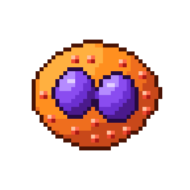

# Eosinófilo

| Campo | Valor |
|---|---|
| Arquivo | `sprites/png/eosinofilo.png` (48×48) · `sprites/png_x8/eosinofilo.png` (384×384) |
| Índice no spritesheet | 4 (x = 192 px) |
| Tamanho real | 12–17 µm |
| Área ocupada no sprite | 33×28 px |
| Paletas | Corpo → `EOS`, Grânulos → `EOS_GRAN`, Núcleo → `NUC_PURPLE` |

## Biologia

Representa 1–4 % dos leucócitos. Combate parasitas grandes (helmintos) liberando a proteína básica principal e outras proteínas tóxicas dos grânulos. Participa de alergias e da asma. Núcleo bilobado ("óculos") e grânulos grandes que coram com eosina (vermelho-alaranjado).

## Como reconhecer no sprite

- Oval **laranja** com **núcleo roxo bilobado**
- 13 grânulos 2×2 vermelhos com brilho e sombra

## Construção (camadas, de trás para frente)

1. Corpo: elipse rx 15,2 × ry 12,6 com irregularidade (harmônicos 4 e 3)
2. Lobos: elipses 4,7 × 5,6 em (19, 23,6) e (29,5, 24,6), unidos por uma ponte de 2,2 px
3. Contorno do núcleo sobre o citoplasma
4. Grânulos 2×2: pixel sup-esq = *hi*, sup-dir = *light*, inf-dir = *dark*, resto = *base*; distância mínima de 3,7 px, longe do núcleo

## Cores

| Parte | Contorno | Sombra | Meio-tom | Base | Luz | Brilho |
|---|---|---|---|---|---|---|
| **Corpo** `EOS` | `#4a1405` | `#c8481a` | `#ef6e1e` | `#ff8f1f` | `#ffb040` | `#ffe0a0` |
| **Grânulos** `EOS_GRAN` | `#5a0a05` | `#a81a14` | `#d92b1f` | `#f04a30` | `#ff6b4a` | `#ffc0a0` |
| **Núcleo** `NUC_PURPLE` | `#260a40` | `#4b1a8c` | `#6b2fd0` | `#8a4cf0` | `#b58bff` | `#e3d0ff` |

## Ideias de animação

- Degranulação: grânulos "saltando" para fora (deslocar 2–4 px e sumir)
- Flutuar lentamente com rotação de ±5°
