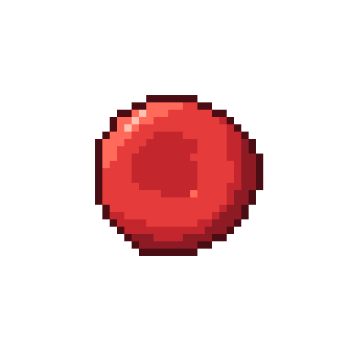

# Hemácia (eritrócito)

| Campo | Valor |
|---|---|
| Arquivo | `sprites/png/hemacia.png` (48×48) · `sprites/png_x8/hemacia.png` (384×384) |
| Índice no spritesheet | 0 (x = 0 px) |
| Tamanho real | 7–8 µm de diâmetro, ~2 µm de espessura |
| Área ocupada no sprite | 23×22 px |
| Paletas | Corpo → `RED` |

## Biologia

Transporta O₂ dos pulmões aos tecidos e devolve parte do CO₂, graças à hemoglobina. É a célula mais numerosa do sangue (~5 milhões/µL). Não tem núcleo nem organelas. O formato de disco bicôncavo aumenta a superfície de troca e permite que ela se dobre para passar em capilares. Vive cerca de 120 dias.

## Como reconhecer no sprite

- Disco vermelho **sem núcleo**
- Centro afundado (mais escuro), borda em anel mais clara
- Brilho de 3 px no anel superior esquerdo

## Construção (camadas, de trás para frente)

1. Elipse rx 10,6 × ry 10,2 com leve irregularidade (harmônico 3, amplitude 0,025)
2. Sombreamento de **toro**: pico da borda em 68 % do raio; fora do pico a normal aponta para fora, dentro aponta para dentro (×0,75)
3. Centro (raio < 30 %) em tom *meio-tom* chapado
4. Contorno externo de 1 px
5. Brilho (tom *hi*) em 3 pixels do anel superior esquerdo

## Cores

| Parte | Contorno | Sombra | Meio-tom | Base | Luz | Brilho |
|---|---|---|---|---|---|---|
| **Corpo** `RED` | `#4a0d14` | `#8e1b24` | `#c4262e` | `#e63b3b` | `#ff6a5a` | `#ffc2b0` |

## Ideias de animação

- Rolar/girar ao longo do vaso (rotação de 90° em 4 quadros funciona bem)
- Achatar (escala 1,0 × 0,8) ao passar por capilares
- Fluxo em fila, levemente desalinhado
- Variação "de lado": achatar para 1,0 × 0,35 para simular visão lateral
