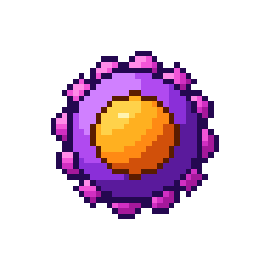

# Linfócito T CD4+ (auxiliar / helper)

| Campo | Valor |
|---|---|
| Arquivo | `sprites/png/linfocito_t_cd4.png` (48×48) · `sprites/png_x8/linfocito_t_cd4.png` (384×384) |
| Índice no spritesheet | 7 (x = 336 px) |
| Tamanho real | 7–10 µm |
| Área ocupada no sprite | 30×30 px |
| Paletas | Corpo → `CD4_BODY`, Receptores (bolinhas) → `MAGENTA`, Núcleo → `NUC_ORANGE` |

## Biologia

Reconhece antígenos apresentados no **MHC de classe II**. Coordena a resposta imune liberando citocinas: ajuda o linfócito B a produzir anticorpos, ativa macrófagos e sustenta os T CD8+. Subtipos: Th1, Th2, Th17, Tfh e Treg. É o alvo do HIV.

## Como reconhecer no sprite

- Corpo **violeta** redondo
- **12 "bolinhas" rosa** na membrana (receptores)
- Núcleo grande, laranja e redondo (pouco citoplasma, típico do linfócito)

## Construção (camadas, de trás para frente)

1. 12 bolinhas (elipse 2,4 px) a 11,6 px do centro, a cada 30° começando em 8°, sombreadas sem brilho
2. Corpo: elipse 11,2 × 11,0 sombreada por cima
3. Contorno externo + anel do corpo
4. Núcleo: círculo de raio 6,8 no centro, sombreado, com contorno

## Cores

| Parte | Contorno | Sombra | Meio-tom | Base | Luz | Brilho |
|---|---|---|---|---|---|---|
| **Corpo** `CD4_BODY` | `#240850` | `#5a1a9c` | `#8a2fd8` | `#b04af0` | `#d080ff` | `#f0d0ff` |
| **Receptores (bolinhas)** `MAGENTA` | `#3a0640` | `#a5189b` | `#d12fc2` | `#f255d8` | `#ff8be8` | `#ffd0f6` |
| **Núcleo** `NUC_ORANGE` | `#5a1c00` | `#d1500a` | `#ff8a14` | `#ffb020` | `#ffd24a` | `#fff3b0` |

## Ideias de animação

- Pulsar suave (escala 1,00 ↔ 1,04)
- Ao ativar: soltar pequenos pontos (citocinas) em direção às células vizinhas
