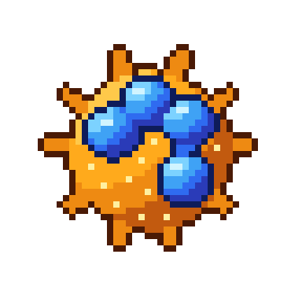

# Neutrófilo

| Campo | Valor |
|---|---|
| Arquivo | `sprites/png/neutrofilo.png` (48×48) · `sprites/png_x8/neutrofilo.png` (384×384) |
| Índice no spritesheet | 3 (x = 144 px) |
| Tamanho real | 12–15 µm |
| Área ocupada no sprite | 35×33 px |
| Paletas | Corpo e espículas → `ORANGE`, Núcleo → `NUC_BLUE` |

## Biologia

Leucócito mais abundante (50–70 %). É a primeira linha de defesa contra bactérias e fungos: chega rápido por quimiotaxia, fagocita, degranula e pode lançar NETs (redes de DNA). Núcleo segmentado em 3 a 5 lobos. Vive horas a poucos dias e forma o pus.

## Como reconhecer no sprite

- Corpo **laranja espiculado** (10 espículas)
- Núcleo **azul com 4 lobos** ligados por filamentos
- 11 grânulos pontuais claros no citoplasma

## Construção (camadas, de trás para frente)

1. 10 espículas afinadas (3,2 → 0,9 px), de 11 a 15,6 px do centro, a cada 36° (±5°), tom *meio-tom*
2. Corpo: elipse rx 12,6 × ry 12,4 (harmônico 4, amplitude 0,02), sombreado
3. Contorno externo unindo corpo + espículas
4. Lobos (elipse 3,9 × 3,7) em (18,21) (23,5,16,6) (30,19,5) (29,5,28,5), cada um sombreado individualmente
5. Filamentos entre lobos com 1,7 px de largura, tom *meio-tom* azul
6. Contorno do núcleo desenhado sobre o citoplasma
7. Grânulos: 11 pixels *hi* a ≥ 3,2 px de distância entre si e longe do núcleo

## Cores

| Parte | Contorno | Sombra | Meio-tom | Base | Luz | Brilho |
|---|---|---|---|---|---|---|
| **Corpo e espículas** `ORANGE` | `#4a1a05` | `#c25a0f` | `#ee8a12` | `#ffaa1c` | `#ffc94a` | `#fff0a0` |
| **Núcleo** `NUC_BLUE` | `#0e1c5a` | `#2a3bb8` | `#2f6bf0` | `#3fa2f5` | `#7cd2ff` | `#d0f4ff` |

## Ideias de animação

- Rastejar (diapedese): esticar a 1,15 × 0,9 e voltar, alternando a direção
- Espículas pulsando (alternar dois sprites com espículas a 90 % e 100 %)
- Fagocitose: abrir dois pseudópodes que envolvem a bactéria
