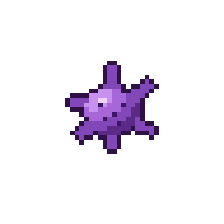

# Plaqueta ativada

| Campo | Valor |
|---|---|
| Arquivo | `sprites/png/plaqueta_ativada.png` (48×48) · `sprites/png_x8/plaqueta_ativada.png` (384×384) |
| Índice no spritesheet | 2 (x = 96 px) |
| Tamanho real | 2–3 µm (corpo) + pseudópodes |
| Área ocupada no sprite | 20×20 px |
| Paletas | Corpo e pseudópodes → `PLT` |

## Biologia

Quando entra em contato com colágeno exposto ou com trombina, a plaqueta muda de forma, emite pseudópodes (filopódios), libera ADP e tromboxano e passa a se ligar ao fibrinogênio e a outras plaquetas.

## Como reconhecer no sprite

- Mesmo corpo lilás da plaqueta
- 6 pseudópodes finos irradiando
- 5 grânulos escuros

## Construção (camadas, de trás para frente)

1. 6 pseudópodes afinados (largura 3,0 → 1,1 px) nos ângulos −80, −25, 30, 85, 140, 200°, comprimento 9,5 ± 1,5 px, saindo de 3 px do centro, em tom *meio-tom*
2. Corpo: elipse rx 5,8 × ry 5,0, sombreado por cima dos pseudópodes
3. Grânulos e contorno externo (que une corpo + pseudópodes)

## Cores

| Parte | Contorno | Sombra | Meio-tom | Base | Luz | Brilho |
|---|---|---|---|---|---|---|
| **Corpo e pseudópodes** `PLT` | `#2e1245` | `#5b2a86` | `#8348b8` | `#a867d8` | `#c791ee` | `#efd2ff` |

Cores avulsas: `#3d1666` Grânulos

## Ideias de animação

- Pseudópodes "crescendo": desenhar com 40 %, 70 % e 100 % do comprimento
- Pequena vibração (±1 px) enquanto se prende à lesão
